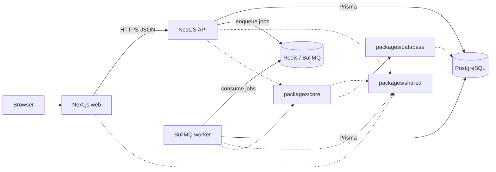

# DevPulse Architecture

## Document status

This document records the approved architecture direction and separates what is
implemented from what is planned. The repository currently contains the root pnpm
workspace, the application scaffolds, the Prisma database package, the initial
schema and migration, and email/password authentication with database-backed
sessions. Registration, login, current-user lookup, session validation, logout,
workspace creation, membership-filtered workspace listing and retrieval, project
creation, project listing, individual project retrieval, project updates, and
project deletion are implemented. Project creation includes workspace-scoped
authorization, validation, duplicate-repository checks, and atomic
project-plus-repository writes, but its successful path depends on a GitHub App
repository resolver that is still pending; the default resolver returns `503`.
Repository resolution requires an `ACTIVE` GitHub installation that belongs to
the path workspace. Project listing requires any workspace membership and
filters, orders, and paginates projects by the path workspace. Individual project
retrieval checks workspace membership and scopes project lookup by both project
ID and path workspace ID. Project updates and deletion require `OWNER` or `ADMIN`
membership, scope all writes by project ID and path workspace ID, and preserve the
repository unless the whole project aggregate is deleted.
PostgreSQL persistence has been verified against isolated PostgreSQL instances.
The Docker Compose development database, Redis, and BullMQ are not implemented or
verified yet.

## Architecture summary

DevPulse is a **modular monolith** with one HTTP API deployable and one
independent background worker deployable. Both processes share domain code and
one PostgreSQL database.

Workspace is the tenant boundary. For the MVP, projects are workspace-scoped:
every Project belongs to exactly one Workspace, and every connected GitHub
Repository belongs to exactly one Project and therefore exactly one Workspace.

This is not a microservice architecture:

- There is one repository and one deployment domain.
- There is one primary database.
- The API and worker share internal packages at build time.
- They do not call each other through a private HTTP API.
- The worker exists as a separate process so background work can fail, restart,
  and scale independently of HTTP traffic.

## Monorepo layout

| Path | Responsibility | Status |
| --- | --- | --- |
| `apps/web` | Next.js browser application | Implemented scaffold |
| `apps/api` | NestJS HTTP API and BullMQ job producer | Implemented scaffold |
| `apps/worker` | BullMQ consumers and scheduled work | Implemented scaffold |
| `packages/shared` | Framework-agnostic types, constants, and pure utilities | Planned |
| `packages/database` | Prisma schema, migrations, and database client access | Implemented: initial schema and `init_devpulse` migration |
| `packages/core` | Shared business use cases; created only when needed | Planned |
| `docs/` | Project documentation | In progress |
| `docker/` | Local infrastructure and deployment configuration | Planned |

## Component responsibilities

### Frontend: `apps/web`

- Renders the browser user interface with Next.js and TypeScript.
- Uses Tailwind CSS and shadcn/ui for presentation.
- Calls the API over HTTP; it never connects directly to PostgreSQL or Redis.
- May import framework-agnostic types and utilities from `packages/shared`.
- Must not contain server secrets or receive GitHub credentials.

### API: `apps/api`

- Exposes the public HTTP API using NestJS.
- Handles authentication, authorization, request validation, and response
  shaping.
- Validates opaque session cookies through a reusable authentication guard and
  exposes only a safe authenticated user identity to controllers.
- Filters workspace listing and retrieval by authenticated membership in the
  database query and maps records to safe API responses.
- Owns HTTP-specific concerns such as controllers, guards, and interceptors.
- Reads and writes application data through `packages/database` or business use
  cases in `packages/core`.
- Enqueues background work through BullMQ when a request should not wait for a
  long-running operation.
- Must not contain a second copy of business logic that is also needed by the
  worker.

### Worker: `apps/worker`

- Runs independently from the API as a BullMQ consumer.
- Processes synchronization, aggregation, and scheduled background jobs.
- Uses the same domain logic and database access packages as the API.
- Must not expose a public HTTP API.
- Must be safe to restart; jobs should be idempotent where practical.

### Database: PostgreSQL and `packages/database`

- PostgreSQL is the source of truth for application and metadata records.
- Prisma is the approved data-access layer.
- `packages/database` owns the Prisma schema, migrations, generated client
  access, and database connection creation.
- The package uses Prisma 7 with `prisma.config.ts`, the `prisma-client`
  generator, and the PostgreSQL driver adapter.
- The generated Prisma client is emitted as CommonJS to match the current API and
  worker TypeScript builds.
- The package exports a single client factory. Each process creates one client and
  owns its connection and shutdown lifecycle.
- Initial application models are defined in the package schema. The
  `init_devpulse` migration is committed, was applied during verification against
  an isolated PostgreSQL instance, and is verified as up to date there. The Docker
  Compose development database still needs the migration applied once Docker
  access is available.
- No application or other package maintains a separate Prisma schema.
- The GitHub external repository identifier is stored and protected by a
  uniqueness constraint that prevents the same repository from being actively
  connected to multiple projects or workspaces in the MVP.
- Repository disconnection stops active synchronization and is separate from
  repository data deletion; retained historical data follows the retention
  policy.

### Queue: Redis and BullMQ

- Redis stores BullMQ queues, job state, retries, and scheduling metadata.
- The API enqueues jobs; the worker consumes them.
- Redis is not the source of truth for business records.
- Job payloads must be validated and should contain identifiers rather than
  large object graphs or secrets.

### Shared code: `packages/shared` and `packages/core`

- `packages/shared` contains dependency-free TypeScript types, constants, job
  names, and pure utilities.
- `packages/core` contains shared business use cases when the API and worker both
  need them. It may depend on `packages/shared` and `packages/database`.
- Framework-specific objects such as NestJS request objects must not enter
  `packages/shared` or `packages/core`.

## Communication between components

Planned request flow:

1. The browser calls the API over HTTPS.
2. The API authenticates the user and authorizes access to the requested
   workspace.
3. The API reads or writes PostgreSQL through the database package.
4. For long-running work, the API enqueues a BullMQ job in Redis.
5. The worker consumes the job and calls the same shared business logic.
6. The worker reads or writes PostgreSQL and records job outcomes.
7. The API returns results to the browser on later requests.

The API and worker do not call each other directly. They coordinate through
database state and queue contracts.

## Dependency direction

```text
packages/shared      -> no internal package dependencies
packages/database    -> may depend on shared only if necessary
packages/core        -> may depend on shared and database
apps/api             -> may depend on core, database, and shared
apps/worker          -> may depend on core, database, and shared
apps/web             -> may depend on shared only
```

Enforced rules:

- No package imports from `apps/*`.
- No application imports from another application.
- `apps/web` does not access PostgreSQL or Redis.
- `apps/worker` does not expose HTTP.
- Cross-package imports use package names, not relative paths.
- Business rules used by both API and worker live in `packages/core`.

## Architecture diagram



## Workspace isolation

DevPulse is planned as a multi-workspace system. Workspace isolation is an
architectural requirement:

- Every workspace-scoped record must be traceable to exactly one workspace.
- Every Project belongs to exactly one Workspace.
- Every connected GitHub Repository belongs to exactly one Project and
  therefore exactly one Workspace.
- A GitHub repository cannot be actively connected to multiple Projects or
  Workspaces in the MVP.
- Every workspace-scoped API operation must verify membership before reading or
  writing data. Workspace listing and retrieval currently enforce this in the
  database query and return `404` for nonexistent or inaccessible workspaces.
- Queries must include a workspace constraint rather than filtering after fetch.
- Unique constraints should include the workspace where collisions would
  otherwise cross tenant boundaries, except for the GitHub external repository
  identifier, which is unique across active connections in the MVP.
- Cross-workspace references must be rejected and tested.
- Repository disconnection is separate from repository data deletion; retained
  historical data follows the retention policy.

The exact enforcement mechanism, including whether database row-level security is
used in addition to application checks, remains open.

## Workspace ownership and membership integrity

- The supported roles remain `OWNER`, `ADMIN`, `MEMBER`, and `VIEWER`; no new
  roles are introduced.
- Workspace creation derives the creator from the authenticated session and
  atomically inserts the workspace plus an `OWNER` membership.
- Workspace access is based on the existence of the membership row. There is no
  soft-deleted membership state, so removing a row removes access.
- Request DTOs do not accept `userId`, `role`, or membership fields. Role
  assignment is server-controlled; ordinary workspace create and update requests
  cannot choose a role.
- The database enforces the last-owner invariant with a deferred workspace-owner
  trigger and a membership delete/demotion trigger. The membership trigger uses a
  per-workspace advisory lock so concurrent changes are serialized rather than
  relying only on an application-level check.
- The database trigger does not authenticate or authorize the actor. Application
  services must still verify session identity and owner permission.
- Member management, role changes, invitations, and ownership transfer are not
  implemented. The intended ownership-transfer sequence is documented in
  `DATABASE_DESIGN.md`; it must promote the new owner before demoting the old
  owner in one transaction.

## Project lifecycle and repository ownership

A DevPulse Project is a minimal workspace-scoped container for one connected
GitHub repository. It is not a task tracker, issue board, or general
project-management system.

The target MVP invariant is: one Project belongs to exactly one Workspace and is
connected to exactly one GitHub Repository. The implemented schema enforces the
workspace relationship, at most one repository per project, and the repository's
workspace matching its project's workspace. It does not yet enforce that a
project has a repository at commit time, and a Repository's installation is not
constrained to the same workspace by a database composite foreign key.

Project creation is implemented as one atomic operation after repository
selection through the GitHub App. The API resolves the repository from the
workspace's active installation, validates that the installation belongs to the
path workspace, and requires `ACTIVE` installation status before deriving
canonical GitHub metadata server-side. It does not accept a project without a
repository, and clients do not submit repository owner names, URLs, visibility,
or other GitHub metadata manually. A project-without-repository state is not
needed for the MVP and would add an empty state, duplicate lifecycle rules, and
ambiguous repository ownership.

Repository resolution is isolated behind a `GITHUB_REPOSITORY_RESOLVER` seam.
GitHub App verification is not implemented yet, so the default resolver rejects
with `503` and no project is created. The repository-installation workspace
relationship is currently enforced in application code during project creation;
a database-level composite constraint remains planned.

A GitHub repository may be connected to only one DevPulse project at a time. The
global `githubId` uniqueness constraint enforces this. A disconnected repository
remains attached to its existing project so its history and identity remain
consistent; it cannot simultaneously appear in another project or workspace.
Reassigning a repository to another project or workspace requires an explicit
future transfer decision and is not part of the MVP.

Repository disconnection is not project deletion. Disconnection stops active
synchronization and records the disconnection timestamp while retaining the
project and historical metadata. Project deletion is a separate, explicit
permanent local purge that does not modify the repository on GitHub and does not
uninstall the workspace's GitHub App installation. In one transaction it removes
webhook events tied to the project's repository, recommendations, risk
assessments, pull requests, issues, workflow runs, the project's exclusively owned
repository record, and the project record. It preserves the workspace, users,
sessions, memberships, the GitHub installation record, other projects, unrelated
repositories, and webhook events that cannot be attributed to the deleted
project. Deleting the local repository record releases its globally unique
GitHub repository identifier for a future connection; reconnection remains a
separate future workflow.

Project deletion versus GitHub App disconnection or uninstallation:

- Deleting a project removes only DevPulse-local project data.
- Disconnecting a repository changes repository connection state and retains its
  history; it is not implemented as a separate endpoint.
- Uninstalling the GitHub App is an external GitHub operation. No project
  endpoint calls GitHub to uninstall or modify an installation.

Project authorization is workspace-scoped:

| Operation | OWNER | ADMIN | MEMBER | VIEWER | Non-member |
| --- | --- | --- | --- | --- | --- |
| List/read projects | Allowed | Allowed | Allowed | Allowed | `404` |
| Create/update/delete projects | Allowed | Allowed | `403` | `403` | `404` |

`MEMBER` and `VIEWER` are read-only for project-management operations. Project
queries must include the workspace constraint and must return `404` for
nonexistent and cross-workspace projects.

## Implemented versus planned

| Capability | Status |
| --- | --- |
| Root pnpm workspace and Git repository | Implemented |
| Foundational documentation | In progress |
| Next.js application | Implemented scaffold |
| NestJS API application | Implemented scaffold |
| Independent worker application | Implemented scaffold |
| PostgreSQL and Prisma setup | In progress: database package, initial schema, `init_devpulse` migration, and `enforce_workspace_owner_invariants` migration added; live persistence and ownership triggers verified on isolated PostgreSQL instances; Compose development database pending |
| Redis and BullMQ setup | Planned |
| Authentication and workspace authorization | In progress: email/password registration, login, database-backed sessions, session validation, current-user lookup, logout, workspace creation, membership-filtered workspace listing/retrieval/updates, owner-only deletion, and database-enforced last-owner protection implemented; member management, invitations, role changes, ownership transfer, and broader RBAC planned |
| Project management | In progress: schema supports workspace-scoped projects and one repository per project; authenticated project creation with owner/admin authorization, validation, duplicate checks, atomic project-plus-repository writes, and rollback is implemented behind a GitHub repository resolver seam. The resolver returns `503` until GitHub App verification is implemented. Membership-authorized, workspace-scoped project listing with deterministic ordering, pagination, and repository details is implemented. Membership-authorized individual project retrieval scoped by project ID and path workspace ID is implemented. Owner/admin, workspace-scoped project updates with partial name/description validation and repository preservation are implemented. Owner/admin, workspace-scoped project deletion with transaction-scoped aggregate removal, local repository deletion, webhook-event attribution, and preservation of installations and unrelated workspace data is implemented. Repository disconnection and reconnection flows remain planned |
| GitHub metadata integration | Planned |

## Architecture decisions

Selected decisions:

- GitHub integration uses a GitHub App.
- Authentication uses database-backed server-side sessions. Login creates a
  seven-day session whose raw token is carried only in an HTTP-only cookie and
  whose SHA-256 hash is stored in PostgreSQL. Session validation does not extend
  expiration, and logout revokes only the current session.
- Workspace creation derives the creator from the authenticated session and
  atomically creates the workspace and an `OWNER` membership.
- Workspace listing and retrieval filter by active membership in the database.
  Inaccessible and nonexistent workspaces both return `404`.
- The last-owner invariant is enforced by PostgreSQL triggers in addition to
  application transactions. Concurrent membership changes are serialized with a
  per-workspace advisory lock.
- Workspace listing uses validated offset pagination because per-user workspace
  sets are expected to be small; cursor pagination remains preferred for larger
  collections.
- Projects are minimal workspace-scoped containers for exactly one GitHub
  repository. They are not general project-management records. Project creation is
  atomic with repository selection from an active GitHub installation; repo-less
  project creation is not part of the MVP. Repository resolution is delegated to a
  GitHub App resolver seam, and the current default resolver returns `503` until
  GitHub integration is implemented.
- `MEMBER` and `VIEWER` are read-only for project-management operations.
  `OWNER` and `ADMIN` may create, update, and delete projects.
- Project deletion is a permanent local purge of the project aggregate and its
  exclusively owned repository record. It preserves the workspace, GitHub
  installation, users, sessions, memberships, other projects, unrelated
  repositories, and webhook events that cannot be attributed to the deleted
  project. It does not call GitHub to delete a repository or uninstall the App.
- Repository disconnection is separate from project deletion. Reassigning a
  repository between projects or workspaces is not supported in the MVP.

Open decisions:

- Exact job contracts, retry policy, and dead-letter handling
- How webhooks are received and verified
- Whether metrics are computed on demand or materialized by scheduled jobs
- Repository reconnection behavior after disconnection and how retained
  historical data is handled
- Whether disconnected repository records may ever be reassigned to another
  project or workspace
- Whether `Project.slug` remains necessary after the UUID-based API is finalized
- The minimum GitHub permissions and repository-discovery flow required for the
  project-creation resolver
- Deployment topology and hosting provider
- Whether database row-level security is required in addition to application
  authorization
