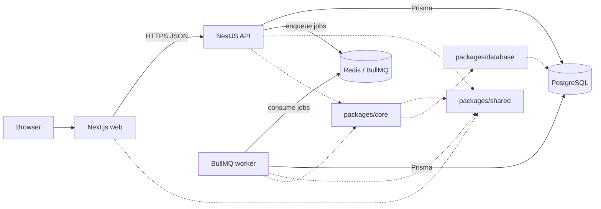

# DevPulse Architecture

## Document status

This document records the approved architecture direction and separates what is
implemented from what is planned. The repository currently contains the root pnpm
workspace, the application scaffolds, and the Prisma database package. PostgreSQL
runtime integration, Redis, and BullMQ are not implemented yet.

## Architecture summary

DevPulse is a **modular monolith** with one HTTP API deployable and one
independent background worker deployable. Both processes share domain code and
one PostgreSQL database.

Workspace is the tenant boundary. For the MVP, projects are workspace-scoped:
every Project belongs to exactly one Workspace, and every connected GitHub
Repository belongs to exactly one Project and therefore exactly one Workspace.

This is not a microservice architecture:

- There is one repository and one deployment domain.
- There is one primary database.
- The API and worker share internal packages at build time.
- They do not call each other through a private HTTP API.
- The worker exists as a separate process so background work can fail, restart,
  and scale independently of HTTP traffic.

## Monorepo layout

| Path | Responsibility | Status |
| --- | --- | --- |
| `apps/web` | Next.js browser application | Implemented scaffold |
| `apps/api` | NestJS HTTP API and BullMQ job producer | Implemented scaffold |
| `apps/worker` | BullMQ consumers and scheduled work | Implemented scaffold |
| `packages/shared` | Framework-agnostic types, constants, and pure utilities | Planned |
| `packages/database` | Prisma schema, migrations, and database client access | Implemented: initial schema; no migration |
| `packages/core` | Shared business use cases; created only when needed | Planned |
| `docs/` | Project documentation | In progress |
| `docker/` | Local infrastructure and deployment configuration | Planned |

## Component responsibilities

### Frontend: `apps/web`

- Renders the browser user interface with Next.js and TypeScript.
- Uses Tailwind CSS and shadcn/ui for presentation.
- Calls the API over HTTP; it never connects directly to PostgreSQL or Redis.
- May import framework-agnostic types and utilities from `packages/shared`.
- Must not contain server secrets or receive GitHub credentials.

### API: `apps/api`

- Exposes the public HTTP API using NestJS.
- Handles authentication, authorization, request validation, and response
  shaping.
- Owns HTTP-specific concerns such as controllers, guards, and interceptors.
- Reads and writes application data through `packages/database` or business use
  cases in `packages/core`.
- Enqueues background work through BullMQ when a request should not wait for a
  long-running operation.
- Must not contain a second copy of business logic that is also needed by the
  worker.

### Worker: `apps/worker`

- Runs independently from the API as a BullMQ consumer.
- Processes synchronization, aggregation, and scheduled background jobs.
- Uses the same domain logic and database access packages as the API.
- Must not expose a public HTTP API.
- Must be safe to restart; jobs should be idempotent where practical.

### Database: PostgreSQL and `packages/database`

- PostgreSQL is the source of truth for application and metadata records.
- Prisma is the approved data-access layer.
- `packages/database` owns the Prisma schema, migrations, generated client
  access, and database connection creation.
- The package uses Prisma 7 with `prisma.config.ts`, the `prisma-client`
  generator, and the PostgreSQL driver adapter.
- The generated Prisma client is emitted as CommonJS to match the current API and
  worker TypeScript builds.
- The package exports a single client factory. Each process creates one client and
  owns its connection and shutdown lifecycle.
- Initial application models are defined in the package schema. No migration has
  been created or applied yet.
- No application or other package maintains a separate Prisma schema.
- The GitHub external repository identifier is stored and protected by a
  uniqueness constraint that prevents the same repository from being actively
  connected to multiple projects or workspaces in the MVP.
- Repository disconnection stops active synchronization and is separate from
  repository data deletion; retained historical data follows the retention
  policy.

### Queue: Redis and BullMQ

- Redis stores BullMQ queues, job state, retries, and scheduling metadata.
- The API enqueues jobs; the worker consumes them.
- Redis is not the source of truth for business records.
- Job payloads must be validated and should contain identifiers rather than
  large object graphs or secrets.

### Shared code: `packages/shared` and `packages/core`

- `packages/shared` contains dependency-free TypeScript types, constants, job
  names, and pure utilities.
- `packages/core` contains shared business use cases when the API and worker both
  need them. It may depend on `packages/shared` and `packages/database`.
- Framework-specific objects such as NestJS request objects must not enter
  `packages/shared` or `packages/core`.

## Communication between components

Planned request flow:

1. The browser calls the API over HTTPS.
2. The API authenticates the user and authorizes access to the requested
   workspace.
3. The API reads or writes PostgreSQL through the database package.
4. For long-running work, the API enqueues a BullMQ job in Redis.
5. The worker consumes the job and calls the same shared business logic.
6. The worker reads or writes PostgreSQL and records job outcomes.
7. The API returns results to the browser on later requests.

The API and worker do not call each other directly. They coordinate through
database state and queue contracts.

## Dependency direction

```text
packages/shared      -> no internal package dependencies
packages/database    -> may depend on shared only if necessary
packages/core        -> may depend on shared and database
apps/api             -> may depend on core, database, and shared
apps/worker          -> may depend on core, database, and shared
apps/web             -> may depend on shared only
```

Enforced rules:

- No package imports from `apps/*`.
- No application imports from another application.
- `apps/web` does not access PostgreSQL or Redis.
- `apps/worker` does not expose HTTP.
- Cross-package imports use package names, not relative paths.
- Business rules used by both API and worker live in `packages/core`.

## Architecture diagram



## Workspace isolation

DevPulse is planned as a multi-workspace system. Workspace isolation is an
architectural requirement:

- Every workspace-scoped record must be traceable to exactly one workspace.
- Every Project belongs to exactly one Workspace.
- Every connected GitHub Repository belongs to exactly one Project and
  therefore exactly one Workspace.
- A GitHub repository cannot be actively connected to multiple Projects or
  Workspaces in the MVP.
- Every workspace-scoped API operation must verify membership before reading or
  writing data.
- Queries must include a workspace constraint rather than filtering after fetch.
- Unique constraints should include the workspace where collisions would
  otherwise cross tenant boundaries, except for the GitHub external repository
  identifier, which is unique across active connections in the MVP.
- Cross-workspace references must be rejected and tested.
- Repository disconnection is separate from repository data deletion; retained
  historical data follows the retention policy.

The exact enforcement mechanism, including whether database row-level security is
used in addition to application checks, remains open.

## Implemented versus planned

| Capability | Status |
| --- | --- |
| Root pnpm workspace and Git repository | Implemented |
| Foundational documentation | In progress |
| Next.js application | Implemented scaffold |
| NestJS API application | Implemented scaffold |
| Independent worker application | Implemented scaffold |
| PostgreSQL and Prisma setup | In progress: database package and initial schema added; no migration applied |
| Redis and BullMQ setup | Planned |
| Authentication and workspace authorization | Planned |
| GitHub metadata integration | Planned |

## Open architecture decisions

- Whether GitHub integration uses a GitHub App, OAuth app, or both
- Authentication mechanism for DevPulse users
- Exact job contracts, retry policy, and dead-letter handling
- How webhooks are received and verified
- Whether metrics are computed on demand or materialized by scheduled jobs
- Repository reconnection behavior after disconnection and how retained
  historical data is handled
- Deployment topology and hosting provider
- Whether database row-level security is required in addition to application
  authorization
